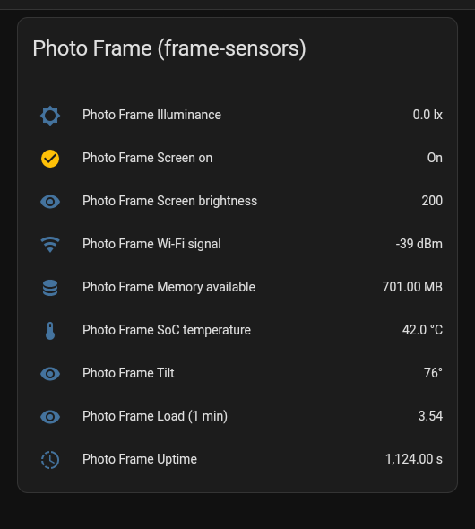

# frame-sensors

A small Android app that turns a cheap Wi-Fi photo frame into a Home Assistant
sensor. It reads the frame's light sensor, accelerometer, temperature, memory,
Wi-Fi signal and screen state and publishes them to MQTT with Home Assistant
discovery, so they show up as entities with no YAML.

It was written for the Allwinner A33 "PF1007L" frame (sold as Humblestead,
BIUFRAME, Anna Bella and others) running Android 6.0.1, after rooting it with
[wesbos/photo-frame-dashboard](https://github.com/wesbos/photo-frame-dashboard).
The full story of getting that frame from stock to a Home Assistant kiosk is
on my blog:
[Turn a £50 Android Photo Frame Into a Home Assistant Dashboard](https://exitcode0.net/posts/android-photo-frame-home-assistant-dashboard/).
This repo is the follow-on: the frame was showing dashboards, but its own
sensors were going to waste.



Nothing is compiled in. The broker address, credentials, publish interval and
device name are set over ADB and stored in the app's private preferences, so
one APK works for any broker and any number of frames.

## What it publishes

One JSON message on `frame-sensors/<id>/state` every `interval` seconds
(default 30), plus an early one when the light level moves by more than 25%.

| key | source | Home Assistant entity |
| --- | --- | --- |
| `illuminance` | `TYPE_LIGHT` sensor (LTR-C216R-14 on the PF1007L), lux | sensor, `illuminance` |
| `screen_on` | `ACTION_SCREEN_ON` / `ACTION_SCREEN_OFF` | binary_sensor |
| `screen_brightness` | `Settings.System.SCREEN_BRIGHTNESS`, 0 to 255 | sensor |
| `wifi_rssi` | `WifiManager`, dBm | sensor, `signal_strength` |
| `memory_available` | `/proc/meminfo` (`MemAvailable`, or free + buffers + cached on old kernels), MB | sensor, `data_size` |
| `soc_temperature` | `/sys/class/thermal/thermal_zone0/temp`, °C | sensor, `temperature`, diagnostic |
| `tilt` | `TYPE_ACCELEROMETER`, degrees from vertical | sensor, diagnostic |
| `load_1m` | `/proc/loadavg` | sensor, diagnostic |
| `uptime` | `SystemClock.elapsedRealtime`, seconds | sensor, `duration`, diagnostic |

Availability is published on `frame-sensors/<id>/availability` (`online` /
`offline`, with an MQTT will). Discovery configs are retained under
`<discovery_prefix>/sensor/frame_sensors_<id>/<key>/config` and all share one
device, so Home Assistant groups them under a single device named `name`.

Any Android 6+ device with the sensors will work. Sensors the device lacks are
left out of the message. The PF1007L's "ambient temperature" sensor is just
the SoC thermistor again, so it is not published.

## Prerequisites

- A rooted frame, or any Android 6+ device, with **ADB access** (USB or
  `adb connect <ip>:5555`). For the PF1007L, see the
  [wesbos start page](https://github.com/wesbos/photo-frame-dashboard/blob/main/docs/pf1007l-start-here.md)
  and the blog post above.
- An **MQTT broker** that Home Assistant is already using, with a username
  and password for the frame. Home Assistant's MQTT integration with discovery
  enabled (the default prefix is `homeassistant`).
- `adb` on your computer (Android platform-tools).
- To **build** rather than use the release APK: a JDK (17 is fine), Android
  build-tools 34 and platform 34, and the Paho MQTT jar. `fetch-deps.sh --all`
  installs all of that under `~/.local/opt` with no root. No Gradle, no
  Android Studio.

## Setup

### 1. Get the APK

Download `frame-sensors.apk` from the
[latest release](https://github.com/Tombo1001/frame-sensors/releases), or build it:

```sh
git clone https://github.com/Tombo1001/frame-sensors.git
cd frame-sensors
./fetch-deps.sh --all        # or just ./fetch-deps.sh if you already have a JDK and the SDK
./build.sh                   # -> build/frame-sensors.apk
```

`build.sh` looks for the JDK at `~/.local/opt/jdk17` and the SDK at
`~/.local/opt/android-sdk`; override with `JAVA_HOME` and `ANDROID_HOME`. The
first build creates a signing key at `~/.frame-sensors.keystore` (override
with `FRAME_SENSORS_KEYSTORE`). Keep it: an APK signed with a different key
will not install over the old one. Bump `VERSION_CODE` for each new install:

```sh
VERSION_CODE=6 VERSION_NAME=1.1 ./build.sh
```

### 2. Install and start

```sh
adb connect 192.168.1.50:5555          # or plug in over USB
adb install -r frame-sensors.apk
adb shell am start -n net.exitcode0.framesensors/.MainActivity
```

The activity starts the background service and closes itself straight away.
Add `--ez show true` to the `am start` if you want to see a status screen on
the frame instead.

### 3. Configure

```sh
adb shell am broadcast -a net.exitcode0.framesensors.CONFIGURE \
  --es host 192.168.1.10 --ei port 1883 \
  --es user mqtt --es pass 'your-password' \
  --ei interval 30 --es name "Photo Frame" --es id photo_frame
```

Only the extras you pass are changed; the rest keep their current values.
The service restarts with the new settings and the entities appear in Home
Assistant within a few seconds.

| extra | type | default | meaning |
| --- | --- | --- | --- |
| `host` | string | (required) | broker hostname or IP |
| `port` | int | `1883` | broker port (plain TCP) |
| `user`, `pass` | string | none | broker credentials |
| `interval` | int | `30` | seconds between publishes (minimum 5) |
| `name` | string | `Photo Frame` | device name in Home Assistant |
| `id` | string | `photo_frame` | topic segment and entity id prefix; use a different one per frame |
| `discovery_prefix` | string | `homeassistant` | Home Assistant discovery prefix |
| `clear` | boolean | | wipe the stored config |

Other broadcasts:

```sh
adb shell am broadcast -a net.exitcode0.framesensors.STATUS    # config (password masked), MQTT state, last publish
adb shell am broadcast -a net.exitcode0.framesensors.RESTART
adb shell logcat -d -s FrameSensors
```

`tools/frame-sensors-config` wraps all of these:

```sh
export FRAME=192.168.1.50:5555
tools/frame-sensors-config set --host 192.168.1.10 --user mqtt --pass 'your-password'
tools/frame-sensors-config status
tools/frame-sensors-config logs
```

### 4. Make it survive a reboot

On stock Android the app's boot receiver starts the service after a reboot
and there is nothing to do. The PF1007L firmware is different, see below.

## PF1007L notes

This firmware ships a vendor `BackgroundManagerService` that refuses to start
a service for any package outside a whitelist baked into `framework-res.apk`,
until one of that package's activities has run (`skipService ... because of
activity not started` in logcat). It also drops `BOOT_COMPLETED` for those
packages. Two consequences:

- After **every install**, run the `am start` from step 2 once. A plain
  `am startservice` is silently ignored.
- **Boot start** has to come from an app that is allowed to run. If you use
  Fully Kiosk Browser as the kiosk, its "Applications to Run on Start in
  Background" setting does it. Over Fully's REST API:

  ```sh
  curl "http://<frame-ip>:2323/?password=<fully-password>&type=json&cmd=setStringSetting&key=appToRunOnStart&value=net.exitcode0.framesensors"
  ```

  Fully launches the package a few seconds after it comes up, the activity
  starts the service and finishes, and Fully keeps the screen. Any other
  allowed app, or a Home Assistant automation that calls Fully's
  `startIntent`, works the same way.

Other things learned on this unit, in case they save you an evening:

- The Wi-Fi chip has no stored MAC address; the address changes every boot.
  Give the frame a static IP in its own Wi-Fi settings.
- `adb reboot` tends to hang. `adb shell 'svc power reboot'` works.
- Only one computer can hold an ADB-over-Wi-Fi connection at a time; the
  second one sees the device as `offline`.

## How it is built

Plain `aapt2`, `javac`, `d8`, `zipalign` and `apksigner`, driven by
`build.sh`. The only dependency is the Eclipse Paho MQTT v3 client
(`org.eclipse.paho.client.mqttv3` 1.2.5, EPL/EDL). Two things `d8` drops from
that jar are copied into the APK by hand: its `.properties` message bundles
(without them every Paho error is a `MissingResourceException`) and
`META-INF/services/...NetworkModuleFactory` (without it, `no NetworkModule
installed for scheme "tcp"`).

```
AndroidManifest.xml
res/values/strings.xml
src/net/exitcode0/framesensors/
  Config.java           preferences access
  ConfigReceiver.java   CONFIGURE / STATUS / RESTART broadcasts
  BootReceiver.java     BOOT_COMPLETED
  MainActivity.java     starts the service; optional status screen
  SensorService.java    sensors, readers, MQTT, discovery
build.sh, fetch-deps.sh
tools/frame-sensors-config
```

## Licence

MIT. Do what you like with it. If it helps, a link back is appreciated.
